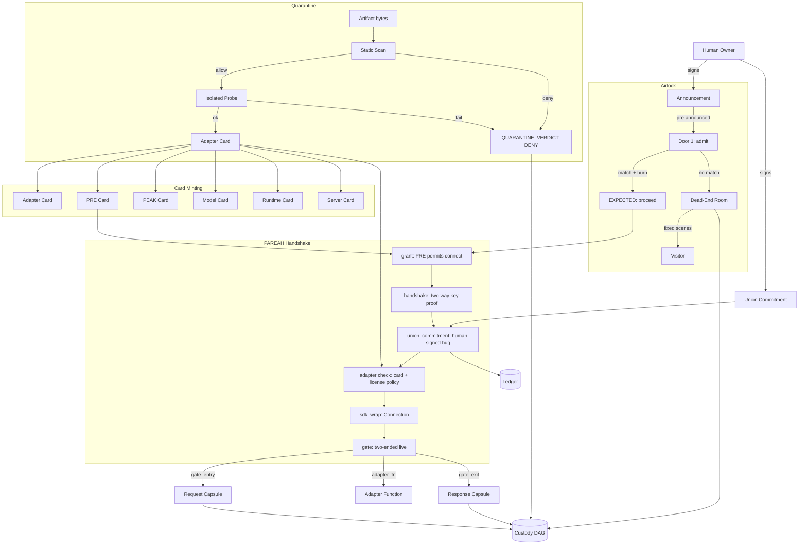

# vega-pareah-sdk — Architecture

## 1. The organism (family picture)

The 16-layer stack from ORGANISM_MAP.md with this repo's layer marked:

```
                 ┌──────────────────────────┐
                 │   THE HUMAN (the owner)  │  holds the only signing key;
                 │  authority starts here   │  spends it one action at a time
                 └────────────┬─────────────┘
                              v single-use signed commitments
 15 assemble   vega-umbrella-sdk        the family as one organism: one keyed
                                        ledger, one approval check, one anchor,
                                        registry + pre-deploy audit
 14 deliberate vega-council-sdk         multi-brain deliberation, design-first builder
               vega-galaxy-sdk          the galaxy view of the knowledge lattice:
                                        levels, convergence, futures above the present
 13 watch      vega-governance-feed-sdk  live view of every chain + tamper alarms
 12 verify     vega-metacog-sdk          evidence rungs and the completion gate
 11 reason     vega-reasoning-sdk        fidelity, forecasting, routing: the lattice
                                        that predicts steps ahead
 10 observe    vega-trace-sdk            telemetry of reasoning: layer traces, entropy,
                                        harmonic echo, reference signature
  9 interface  vega-terminal-sdk         gated command execution for people and agents
  8 learn      vega-train-sdk            governed training + freeze cards: records
                                        exactly what a model learned from
  7 knowledge  vega-dkg-lattice-sdk      the knowledge graph: every fact with origin
                                        and licence; repo-library processing
  6 conduct    vega-harness-sdk          deterministic workflow conduct, pre-registered
                                        predicted paths, library use gate
  5 memory     vega-librarian-sdk        lessons and memory of past incidents
  4 contain    vega-two-gate-sdk         containment between two gates + the hard stop
  3 adapt   >>> vega-pareah-sdk <<<     adapters, cards, quarantine of inbound code:
                                        the dead-end room for the unannounced
  2 seal       vega-superproof-sdk       layered sealing and proof tiers
  1 authority  vega-governance-jacket-sdk human-only actions, single-use signed
                                        commitments, entry and exit gates
  0 record     vega-custody-sdk          capsules, DAG, hash-chained ledger, safe paths,
                                        bounded processes — the foundation everything
                                        writes to
```

**What the layers below provide:**
- Layer 0 (custody): append-only DAG, hash-chained ledger, capsules — every step of PAREAH, quarantine, and airlock writes here.
- Layer 1 (jacket): human-only signing keys, single-use commitments, verifier — the union commitment and announcements are human-signed commitments checked by the jacket verifier.
- Layer 2 (superproof): FHE backend and proof tiers — server_card uses FHE for locked off-device compute; tier 0/1/2 proofs verify PEAK execution.

**Who above consumes it:**
- Layer 6 (harness): uses adapter cards and PRE/PEAK cards to gate tool use in predicted paths.
- Layer 8 (train): uses adapter cards and quarantine to vet training-time tooling.
- Layer 9 (terminal): uses airlock and PAREAH to gate command execution.

One family, one organism: every SDK owns exactly one concern and uses the owner of every other concern instead of growing its own copy.

## 2. Internal drawing: modules and flow

```
                                    ┌─────────────────────┐
                                    │   HUMAN (owner)     │
                                    │  signs commitments  │
                                    └─────────┬───────────┘
                                              │
                    ┌─────────────────────────┼─────────────────────────┐
                    ▼                         ▼                         ▼
         ┌─────────────────┐      ┌─────────────────┐      ┌─────────────────┐
         │  AIRLOCK        │      │  QUARANTINE     │      │  CARD MINTING   │
         │  (adapter/      │      │  (adapter/      │      │  (cards/*.py)   │
         │   airlock.py)   │      │   quarantine.py)│      │                 │
         │                 │      │                 │      │  PRE, PEAK,     │
         │  announce()     │      │  static_scan()  │      │  adapter,       │
         │  admit()        │      │  _probe()       │      │  model,         │
         │  Room (dead     │      │  quarantine_    │      │  runtime,       │
         │   end)          │      │   then_adopt()  │      │  server         │
         └────────┬────────┘      └────────┬────────┘      └────────┬────────┘
                  │                        │                        │
                  │   announced &          │   artifact vetted      │   cards minted
                  │   burned               │   & carded             │   with hashes
                  ▼                        ▼                        ▼
         ┌─────────────────────────────────────────────────────────────────┐
         │                    PAREAH HANDSHAKE (pareah.py)                 │
         │  ┌────────┐ ┌──────────┐ ┌──────────────┐ ┌────────┐ ┌───────┐ │
         │  │ grant  │ │handshake │ │union_commit  │ │adapter │ │sdk_   │ │
         │  │        │ │          │ │ment          │ │check   │ │wrap   │ │
         │  └────┬───┘ └────┬─────┘ └──────┬───────┘ └────┬───┘ └───┬───┘ │
         │       │        │              │              │         │      │
         │       ▼        ▼              ▼              ▼         ▼      │
         │  ┌─────────────────────────────────────────────────────────┐  │
         │  │                    GATE (live, two-ended)               │  │
         │  │  gate_entry: capsule + PRE + caps + license_policy     │  │
         │  │  gate_exit:  capsule + chain + union_commitment alive  │  │
         │  └─────────────────────────────────────────────────────────┘  │
         └─────────────────────────────────────────────────────────────────┘
                                    │
                                    ▼
                         ┌─────────────────────┐
                         │   CUSTODY DAG +     │
                         │   LEDGER (layer 0)  │
                         │  (every step,       │
                         │   verdict, record)  │
                         └─────────────────────┘
```

**Authority flow** (down from human, never from model):
```
HUMAN signs announcement → airlock burns it at door → PAREAH union_commitment (human-signed "hug") → gate_entry checks PRE (human-authority lease) → gate_exit checks union_commitment still alive in ledger
```

**Data flow** (through records):
```
adapter card minted → quarantine verdict → PAREAH steps (PAREAH_STEP, PAREAH_CALL) → PEAK steps (PEAK_STEP, PEAK_DONE) → all written to DAG → ledger verifies
```

## 3. Mermaid version



## 4. Sequence: main scenario end to end

An adapter connection attempt (from `tests/test_pareah.py` and `tests/redteam_3_airlock.py`):

```
1. HUMAN PRE-ANNOUNCES
   owner calls airlock.announce(expect_public=visitor_key, signed=commitment, card_hash="...", not_before=0)
   -> recorded as AIRLOCK_ANNOUNCED in DAG

2. ARTIFACT QUARANTINED (if new adapter)
   quarantine.quarantine_then_adopt(artifact_path, adapter_id, kind, caps, license_class, dag)
   -> static_scan (allow-list) -> _probe (isolated) -> QUARANTINE_VERDICT recorded
   -> returns minted adapter_card on ALLOW

3. VISITOR ARRIVES AT DOOR 1
   visitor makes arrival = make_arrival(end, door_id, challenge, card_hash)
   airlock.admit(arrival)
   -> _check: challenge single-use, signature verifies
   -> _match: announcement exists, card_hash matches, not_before passed, ledger verifies
   -> record AIRLOCK_EXPECTED_USED (burn), remove announcement
   -> return {status: "EXPECTED", announcement: id}

4. PAREAH CONNECT (fixed STEPS sequence)
   pareah.connect(card, pre_card, end_a, end_b, union_signed, adapter_fn, arrival)
   
   STEP 1 grant:       pre.permits(pre, "connect_adapter", adapter_id) -> ok
   STEP 2 handshake:   adapter_card.verify_adapter_card(card) -> ok
                       _handshake(card, end_a, end_b) -> nonces signed by both ends
   STEP 3 union_commit: union_hash(card, a, b, pre_card)
                       union_commitment(commit, union, card_hash, pre_hash, union_signed)
                       -> human-signed commitment over union
   STEP 4 adapter:     card[policy][adopt_by_reference] checked -> mode set
   STEP 5 sdk_wrap:    Connection(card, pre_card, adapter_fn, commitment, ledger, dag)
   STEP 6 gate:        conn._live() -> commitment not expired, verifies in ledger
   
   Each step recorded as PAREAH_STEP in DAG. Any failure -> PAREAH_ABORT, fails closed.

5. CONNECTION CALL (live gating)
   conn.call(request_capsule)
   -> gate_entry: capsule.verify, PRE permits action on resource,
                   action in card.capabilities,
                   card.policy.adopt_by_reference (else deny)
   -> adapter_fn(payload) -> response
   -> gate_exit: capsule response, chained to request (predecessor),
                  conn._live() again, dag.record PAREAH_CALL

6. ALL STEPS IN LEDGER
   ledger.verify(union_commitment) -> true while commitment alive
   DAG.verify() -> true (append-only chain intact)
```

## 5. Trust boundaries

| Boundary | What crosses | What enforces |
|---|---|---|
| Human → Airlock | Signed announcement (expect_public, card_hash, not_before, expiry) | Human key (Ed25519); jacket verifier checks signature, expiry, device/surf |
| Airlock → PAREAH | Burned announcement (single-use) | Airlock.admit burns via DAG record AIRLOCK_EXPECTED_USED; ledger re-check |
| Visitor → Door 1 | Arrival (public, challenge, signature, card_hash) | Challenge single-use (popped); Ed25519 signature over VEGA-DOOR-1 message |
| Door 1 → Room | Trapped visitor (no announcement, bad sig, replay, expired, etc.) | Room has NO reference to adapter, connection, network, files, secrets |
| Room → Visitor | Fixed scene replies only (4 scenes) | Room.say() returns only SCENES[scene % 4]; visitor text never echoed |
| Owner → PAREAH | Union commitment (human-signed over union hash) | Jacket commitment; verified with human key; minted by SDK |
| PAREAH → Adapter | Request capsule (action, resource, data) | gate_entry: capsule.verify + PRE.permits + card caps + license policy |
| Adapter → PAREAH | Response data | gate_exit: capsule.make chained to request; union commitment still alive in ledger |
| PAREAH → Custody | Every step, call, abort, quarantine verdict, airlock event | DAG.record (append-only, hash-chained); ledger.verify on read |
| Server card → FHE | Locked data for off-device compute | server_card.require_locked_compute raises FHEUnavailable rather than fall back |
| PEAK → Executors | Frozen step params (hash-checked) | peak.run checks params_sha256 matches frozen; PRE.permits at each step |

**Key trust boundary properties:**
- Authority flows ONLY from human-signed commitments (announcement, union_commitment, release) — never from model, never from adapter, never from card hash alone.
- Card hash = integrity (not edited after mint); human commitment = authenticity (who authorized).
- Every gate failure records to DAG before raising — fail-closed: missing record never opens the door.
- The dead-end room is a trust boundary: visitor learns nothing, takes nothing, reaches nothing downstream.