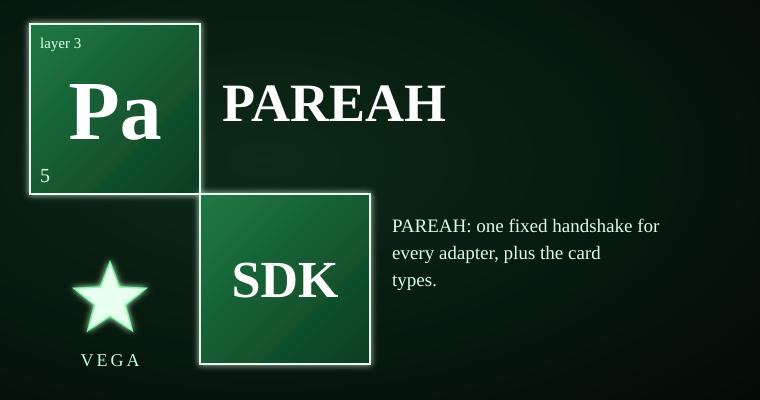

# vega-pareah-sdk



The doorway for any external adapter. PAREAH owns the fixed handshake that every adapter must pass, the card types that describe what an adapter is and what it may do, and the quarantine that tests inbound code before it ever touches the owner's system. An unannounced visitor is held in a dead-end room that holds nothing, answers from a fixed script, and can reach nothing — so an unknown agent learns nothing and takes nothing.

> **Licensing.** Source-available, not open source. Free for personal use; free for registered small businesses (under US$1M revenue and valuation); everyone else needs a commercial license (see LICENSE; for a commercial license write to jasonblasiak.ai.mail@gmail.com). Patent pending. Draft licence text, not yet reviewed by an attorney.

## Why this exists

An AI that can act through tools, servers, or services needs a door — but the door must not be the vulnerability. Prompt-based policies and model self-checks do not solve this: the thing being checked is the thing doing the checking. If it is wrong or steered, the check is wrong too.

PAREAH replaces trust in the model with a fixed, verifiable sequence. Every adapter connection runs exactly six steps in order: grant, handshake, union commitment (the human's signed "hug" over both ends), adapter card check, SDK wrap, and live two-ended gating. The steps are written to an append-only chain as they happen; they cannot be reordered, skipped, or replayed.

Before an adapter is even minted, its artifact passes through a quarantine: one read of the bytes, a strict allow-list static scan (only pure-computation imports), and a bounded probe run in a fresh interpreter with no site-packages. The verdict and the artifact hash are recorded either way. This is a speed bump, not an OS sandbox — hostile code already on the host with the owner's rights will not use the door.

The airlock sits in front of the whole sequence. The owner pre-announces a handshake (a human-signed commitment naming the expected visitor key, a time window, and optionally the adapter card). Door 1 is always open inbound. A visitor that matches the announcement burns it and proceeds to the normal PAREAH sequence. Anything else — wrong key, no signature, replayed challenge, expired announcement, announcement the ledger no longer shows — locks behind door 1 into a room. The room has no adapter function, no network, no files, no secrets. It answers only from four fixed scenes, never echoes visitor text, records only hashes and rule-flag counts, and caps rooms, challenges, and turns so flooding cannot exhaust memory or the chain.

Cards (PRE, PEAK, adapter, model, runtime, server) are data with integrity hashes. A card hash proves the card was not edited after minting; it does not prove who minted it. Authenticity comes from the human's signed union commitment, never from the hash alone. A card can never carry a human-only power (checked at mint and again at every use). License class determines policy: only permissive code may be adopted by reference; every other class stays reference-only and is never copied in. This is a policy gate, not legal advice.

## Capabilities

| Capability | How you can check it |
|---|---|
| Fixed six-step handshake for every adapter (grant → handshake → union_commitment → adapter → sdk_wrap → gate) | `tests/test_pareah.py::check("STEPS is the one fixed sequence")` — `pareah.STEPS` tuple is the constant order |
| Human-signed union commitment binds both ends; cannot be replayed, forged, or reused for another adapter | `tests/test_pareah.py` lines 77–87: replay refused, unsigned refused, wrong adapter refused |
| Adapter card: one shape for all kinds; verified at gate time (policy re-derived from license class) | `src/vega_pareah/adapter/adapter_card.py::verify_adapter_card` — re-checks policy, capabilities, hash |
| PRE card: scoped permissions with expiry capped by human-authority lease; revocable deck | `src/vega_pareah/cards/pre.py::mint_pre`, `verify_pre`, `permits`; `tests/test_cards.py` lines 34–51 |
| PEAK card: frozen DAG job — steps, parameter hashes, dependencies, PRE fixed at freeze; first failure stops | `src/vega_pareah/cards/peak.py::freeze`, `run`; `tests/test_cards.py` lines 53–83 |
| Model card: identity + license class + optional frozen weights hash; API cards honestly say they cannot be hash-checked | `src/vega_pareah/cards/model_card.py::check_model`; `tests/test_cards.py` lines 92–94 |
| Runtime card: code hash + capabilities + limits; drift detected by hash comparison | `src/vega_pareah/cards/runtime_card.py::check_runtime`; `tests/test_cards.py` line 87 |
| Server card: location class + on-device flag; locked data off-device requires FHE, never falls back to plaintext | `src/vega_pareah/cards/server_card.py::require_locked_compute`; `tests/test_cards.py` lines 97–111 |
| Quarantine: strict allow-list static scan + isolated probe; one read of bytes; verdict + hash recorded to DAG | `src/vega_pareah/adapter/quarantine.py::quarantine_then_adopt`; `tests/test_pareah.py` lines 115–145 |
| Airlock: owner pre-announces handshake; door 1 matches and burns announcement; else traps in dead-end room | `src/vega_pareah/adapter/airlock.py::Airlock.announce`, `admit`; `tests/redteam_3_airlock.py` |
| Dead-end room: no adapter function, no network, no secrets; fixed scenes only; no visitor text echoed; caps on rooms/challenges/turns | `src/vega_pareah/adapter/airlock.py::Room`; `tests/redteam_3_airlock.py` lines 99–101, 165–178 |
| License policy gate: six classes; only permissive allows adopt_by_reference; forged policy refused at verify | `src/vega_pareah/cards/license_policy.py`; `tests/redteam_2_cards_handshake_peak.py` lines 114–119 |

## Where it sits in the family

Layer 3 (adapt). Depends on: `vega-custody-sdk` (layer 0, record), `vega-governance-jacket-sdk` (layer 1, authority), `vega-superproof-sdk` (layer 2, seal — for FHE and proof tiers). Consumed by: `vega-harness-sdk` (layer 6, conduct), `vega-train-sdk` (layer 8, learn), `vega-terminal-sdk` (layer 9, interface).

One family, one organism: every SDK owns exactly one concern and uses the owner of every other concern instead of growing its own copy.

```
                 ┌──────────────────────────┐
                 │   THE HUMAN (the owner)  │
                 └────────────┬─────────────┘
                              v
 15 assemble   vega-umbrella-sdk
 14 deliberate vega-council-sdk / vega-galaxy-sdk
 13 watch      vega-governance-feed-sdk
 12 verify     vega-metacog-sdk
 11 reason     vega-reasoning-sdk
 10 observe    vega-trace-sdk
  9 interface  vega-terminal-sdk
  8 learn      vega-train-sdk
  7 knowledge  vega-dkg-lattice-sdk
  6 conduct    vega-harness-sdk
  5 memory     vega-librarian-sdk
  4 contain    vega-two-gate-sdk
  3 adapt   >>> vega-pareah-sdk <<<   adapters, cards, quarantine of inbound code
  2 seal       vega-superproof-sdk
  1 authority  vega-governance-jacket-sdk
  0 record     vega-custody-sdk
```

## Quick start

```python
# Put src/ of this repo and its dependencies (vega-custody-sdk, vega-governance-jacket-sdk, vega-superproof-sdk)
# on PYTHONPATH, then:

from vega_pareah.adapter import adapter_card
from vega_pareah.cards import pre

# Mint an adapter card (reference only — no third-party code is redistributed)
card = adapter_card.mint_adapter_card(
    adapter_id="echo-tool",
    kind="tool",
    capabilities=["echo"],
    code_sha256="ab" * 32,              # sha256 of the artifact bytes
    license_class="permissive",
    reference_uri="https://example.com/echo-tool"
)

# Mint a PRE (permission) for an agent
pre_card = pre.mint_pre(
    subject="agent-1",
    capabilities=["connect_adapter", "echo"],
    scope=["echo", "/work/"],
    lease_seconds=300
)

# Verify the card and check a permission
adapter_card.verify_adapter_card(card)
print(pre.permits(pre_card, "echo", "/work/file.txt"))  # True
print(pre.permits(pre_card, "echo", "/etc/passwd"))     # False (outside scope)
```

## What it does NOT do

- The quarantine is process containment, not an operating-system sandbox: run hostile code in a VM or container.
- The airlock protects what talks to the adapter. Hostile code already running on the machine with the owner's rights will not use the door: the adapter must be the only route (OS or container enforced, owner key in a TPM).
- A careful intruder can recognise a dead end and leave; the room works best on automated and curious agents.
- The room cannot identify a remote model from its weights; it can only measure behaviour.
- Announcements are held in memory: a restart needs them signed again (used announcements stay used because that record is in the chain).
- License matrix is policy, not legal advice; counsel decides edge cases.
- Not independently security-reviewed; cryptography has not been expert-reviewed.
- Reference implementation — work in progress; not hardened for production.
- Silicon and photonic hardware cards are designed, not built (see STATUS.md).

## Tests

163 tests in 5 files, all passing (per STATUS.md). Run each file in `tests/` with `src/` of this repo and its dependencies on PYTHONPATH:

```bash
python tests/test_pareah.py
python tests/test_cards.py
python tests/redteam_1_quarantine.py
python tests/redteam_2_cards_handshake_peak.py
python tests/redteam_3_airlock.py
```

The automated review (REVIEW.md) reports 111 tests across 4 test files + 2 redteam files, all passing, with two info findings (denials are raised even if DAG record fails).

## Status & honesty

Reference implementation, work in progress, not independently security-reviewed, cryptography not expert-reviewed. The licence text is a draft not yet reviewed by an attorney.

This kit details one branch of a broader filed architecture. The remaining branches are the subject of filed disclosures and are outside the scope of this repository.
